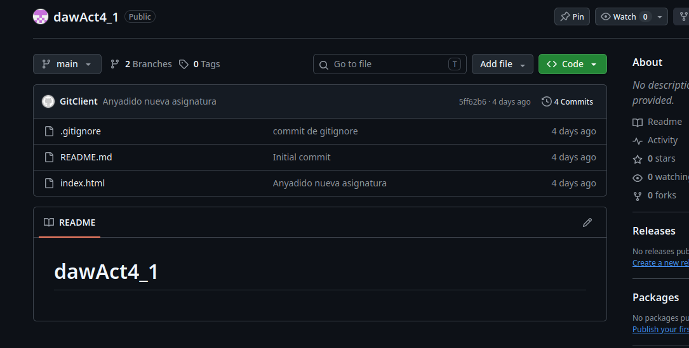

# dawAct4_1

Bienvenido al repositorio oficial del proyecto. Este archivo contiene la información básica y las instrucciones de uso.

## Descripción del Proyecto

Este proyecto busca aprender sobre Markdown
[plantilla avanzada](https://github.com/othneildrew/Best-README-Template).

### Captura de Pantalla

_A continuación se muestra una vista previa de la aplicación:_



### Ejemplo de Uso

Para empezar a usar git haz:
```bash
git init
git config --global user.name "TuNombre"